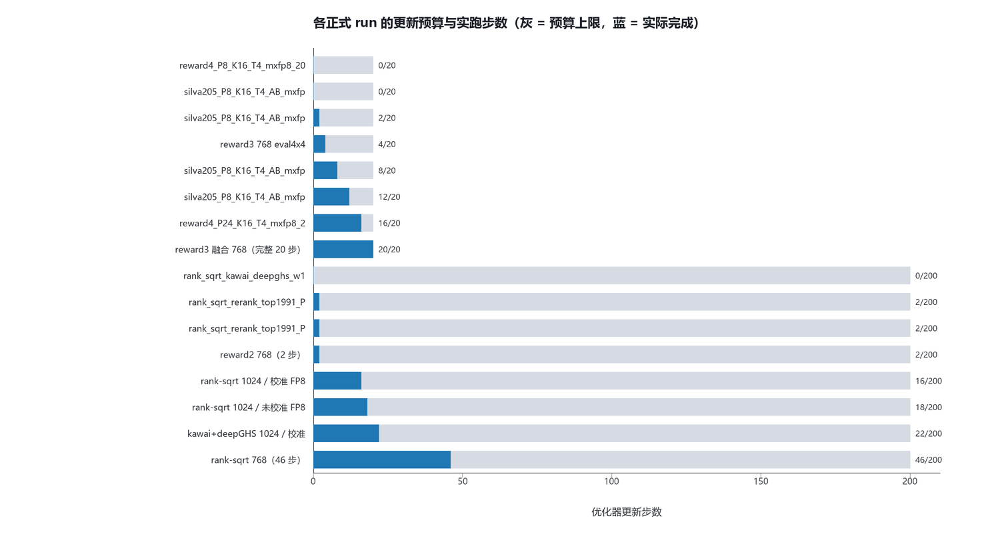
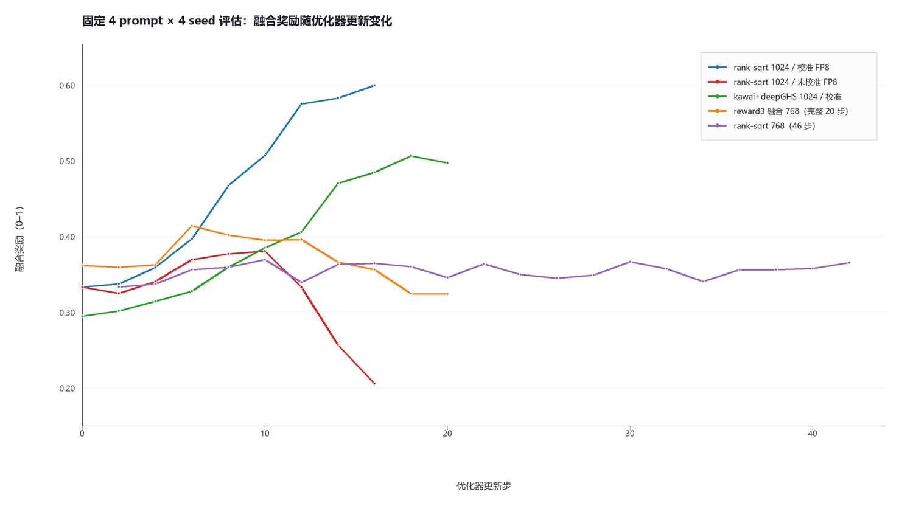
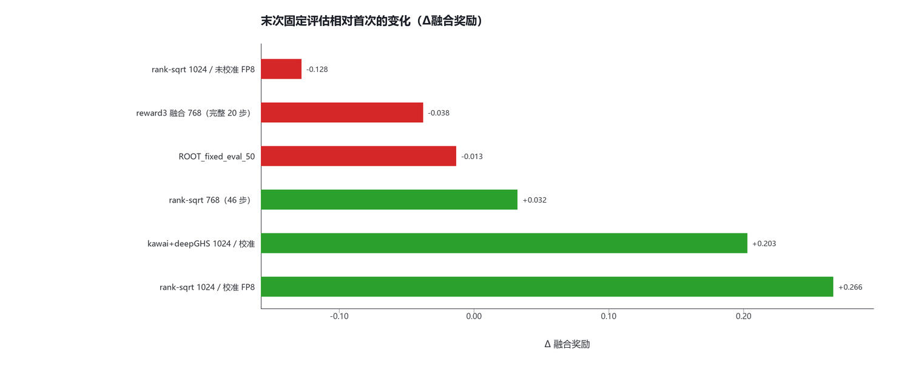
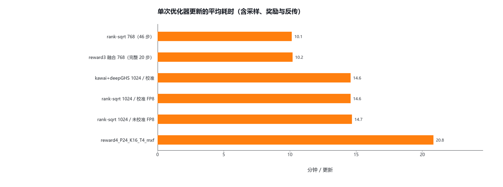
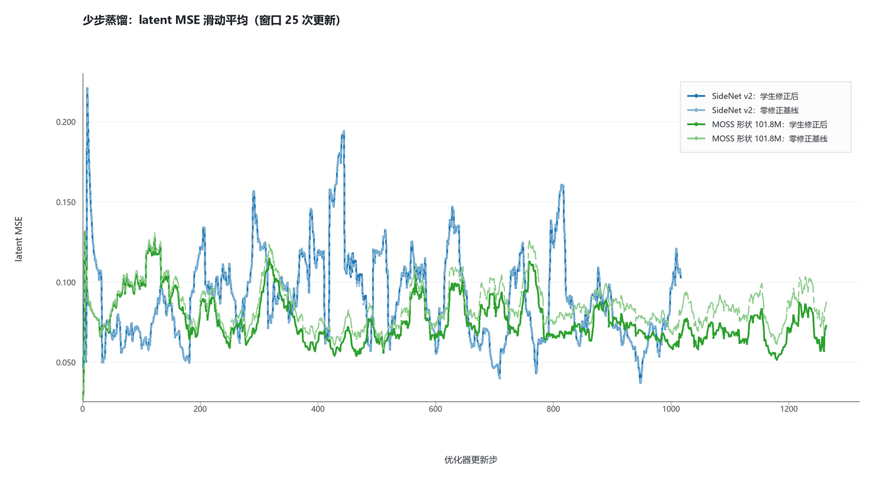

# MOSS-Image 后训练实验报告

**作者：Cloveriris**
**报告日期：2026-11-22　｜　版本：v2（发布版，已脱敏）**
**实验对象：MOSS-Image-Base（Apache-2.0）**
**数据规模：26 个后训练 run、2 个少步蒸馏 run、18 780 张 rollout 图、约 86 GB 产物**

> 本报告为公开发布版本。主机名、用户名、绝对路径、隧道地址等标识已替换为占位符，
> 训练卡以 **架构代号（SM / GB）+ 显存容量** 表示。占位符含义见 `docs/04-sanitization.md`。

---

## 摘要

本报告复盘在 MOSS-Image-Base 上开展的两条后训练路线，并给出可复现的完整记录。

1. **奖励驱动的在线后训练（DiffusionART）**：共 26 个 run 目录——10 个早期脚手架、16 个正式后训练 run（8 个目标 200 更新、8 个目标 20 更新）。**只有 3 个 run 达成自身配置的更新预算**（2 个 20 更新 pilot、1 个 16 更新限长试跑）；8 个 200 更新预算的长跑最远到 **46/200**，多数停在 16–22。
2. **少步蒸馏（BA solver + 学生网络）**：2 个 run，均**中途终止**。101.8 M 参数的 MOSS 形状学生跑到 1264/1972 更新（64%），相对"零修正"基线的 latent MSE 改善约 **17.2%**；15 M 的 SideNet v2 跑到 1016/1972（覆盖 12.9% 的 prompt），改善仅 **0.2%**。
3. **最重要的技术发现**：在其余配置基本一致的前提下，使用**校准过的 MXFP8**（`mxfp8_calibrated`）rollout 的 1024 分辨率 run 在固定评估集上融合奖励 **+0.266**；使用**未校准 MXFP8**（`mxfp8`）的同系列 run 为 **−0.128**。
4. **指标可靠性**：HPSv3++ 原始分在固定 4 prompt × 4 seed 上波动达 ±5（融合贡献 −0.07 量级），是当前奖励融合中最大的噪声源；kawai 与 deepGHS 两个分量给出的方向稳定得多。

结论：**数据完整，但没有一次跑满预算的完整后训练实验**。现有证据足以支撑"奖励后训练方向可行，需重跑 200 更新量级才能定论"，也足以说明"少步蒸馏在当前算力下性价比很低"。

---

## 1. 背景与目标

MOSS-Image 是开源文生图模型（Apache-2.0），由 Qwen3.5 文本编码器、MOSSImageTransformer 主干与 FLUX.2 系 VAE 组成，推理侧以 diffusers 管线交付。

| 权重 | 说明 |
|---|---|
| MOSS-Image-Base | 后训练起点，BF16 DiT 主干（约 5.08 B 参数） |
| MOSS-Image-SFT | 官方 SFT 版本，含预量化的 MXFP8 主干权重 |

后训练要解决两个问题：

- **审美对齐**：Base 出图"画得对但不够好看"，需要审美奖励把分布推向高分区域；
- **采样成本**：48 步采样无法部署，需要 8/12 NFE 的少步近似。

对应两条路线：DiffusionART（在线奖励后训练）与 BA 少步蒸馏。

---

## 2. 实验环境

| 项 | 配置 |
|---|---|
| 计算卡 | **4 × GB203（SM120），16 GB GDDR7** + **1 × GB206（SM120），16 GB GDDR7** |
| CPU / 内存 | 20 核 / 46 GiB（训练可用约 30 GiB） |
| 驱动 | NVIDIA 620.70.06（6xx 分支） |
| 系统 | Ubuntu 24.04 LTS，内核 6.17 |
| 存储布局 | 系统盘 1.8 T（接近写满，仅剩约 27 G）+ 独立数据盘 1.8 T |
| 训练框架 | JAX 0.10.2 / jaxlib 0.10.2 / flax 0.12.7 / optax 0.2.8 |
| 奖励侧框架 | PyTorch 2.11.0+cu130，transformers 4.57.0 |
| 并行方式 | 数据并行 4 卡（DP4）+ 单卡专职学习器；梯度经主机内存汇聚，不使用 NCCL |

精度约定（2026-10-31 明确）：训练语境下"FP8 / MXFP8"一律指 `mxfp8_calibrated`，禁止用未校准 FP8 rollout 训练。该约定被第 6.2 节的数据反向验证。

> 该机型在报错与日志中可复现的硬件特征仅此三项（架构、显存、卡数）；
> 更换为任意 4×16 GB 及以上的 SM90/SM120 机器均可复现本实验的主要结论。

---

## 3. 数据集

数据集本身**未包含在公开包内**（体积与授权原因），仅提供清单与划分文件。

| 文件 | 行数 | 说明 |
|---|---|---|
| `train.jsonl` | 1 991 | 实际训练 prompt |
| `eval_fixed4.jsonl` | 4 | 固定评估 prompt（跨轮次可比） |
| `dropped_overlength.jsonl` | 5 | 超过 1024 token 被丢弃 |
| `source_*.jsonl` | 2 000 | 原始源记录 |

处理链：2 000 条源记录 → 删除 5 条超长 → 1995 → 隔离 4 条旧 heldout ID → **训练 1 991 条**。条件文本按 short/full 双档（288 / 1024 token，short 覆盖 79.36%），正负提示词原样透传（不重排、不补质量词），由文本编码器套官方 chat template。文本特征离线预缓存，训练阶段不持有编码器。

**划分完整性**：训练集与固定评估集无 prompt ID 重叠、无归一化文本重叠，训练从不读取那 4 条评估 prompt 参与梯度。

数据来源、授权与重建方式见 `docs/01-datasets.md`。

---

## 4. 方法 A：DiffusionART 在线奖励后训练

### 4.1 闭环

每个 collection：

1. 取 P 个 prompt，每个采样 K 张图（48 步、CFG 3.0、shift 5.0）；
2. 外部奖励服务对 K 张图打分 → 组内相对优势；
3. 在 T 个时间点（固定 0/15/31/47 或谱采样）构造训练点，做 LoRA 梯度更新；
4. 每 K 张图对应 2 次优化器更新。

标准配置 **P24 × K8 × T4** = 每 collection 192 条轨迹 / 768 个训练点，A/B 各 384（FullDiT 与 Spectrum 1:1）。

### 4.2 关键超参

| 项 | 值 |
|---|---|
| LoRA | rank 48 / alpha 48，attention preset，Kaiming 下采样 + 零初始化上采样 |
| 优化器 | AdamW（动量 0.95、Nesterov、NS 5 步），lr 1e-4，warmup 4 步，weight decay 0 |
| 采样 | 1024×1024 或 768×768，48 步 Euler + MOSS scheduler，guidance 3.0，skip layer 22 |
| 训练时间点 | `[0, 15, 31, 47]`（`training_shift=1.0`） |
| 数值噪声 | `noise_level=0.8` |
| 参考项 | `reference_mse_beta=0.01`（reward3 系列）/ `0.0`（rank-sqrt 系列） |
| rollout 精度 | `mxfp8_calibrated`（合规）/ `mxfp8`（历史遗留，已禁用） |

### 4.3 奖励

| 模型 | 说明 | 融合权重 |
|---|---|---|
| Kawai | 5 类分档（SS/S/A/B/C）分类器 | 0.4 |
| DeepGHS | 审美百分位模型 | 0.4 |
| HPSv3++ | Qwen3-VL-8B 主干，输出 μ/logσ | 0.2 |
| SDG artifact | 瑕疵检测 | 0（本批全部关闭） |

融合方式：各分量归一化后加权，末端 `output_offset=0.5` 与 `output_gain` 缩放得到 fused reward。

### 4.4 优势估计的三个版本

| 版本 | run 前缀 | 机制 |
|---|---|---|
| 奖励融合 | `reward2_*`、`reward3_*` | 直接使用 fused reward 作标量反馈 |
| rank-sqrt | `rank_sqrt_*` | 组内 K 张图按奖励排序，取 sqrt-rank 归一化优势（训练日志 `reward_mean` 恒为 0.5 即其特征） |
| rerank | `rank_sqrt_rerank_*` | rank-sqrt + 分量重排 |

---

## 5. 方法 B：BA 少步蒸馏

教师为冻结的 MOSS-Image-Base（BF16 全量 DiT，1024 方图，CFG 3.0，负分支跳过第 22 层）。学生是**速度残差修正网络**，不替代教师，只在 BA 采样器（双锚点前向 + 后向探测 + 四点 Gauss–Lobatto 校正）每个区间给出带符号步长的修正量。

| run | 学生结构 | 参数量 | 训练方式 |
|---|---|---|---|
| `ba_cnn_att_v2_*` | 深度卷积 + 条件调制 + 降采样自注意力 + 文本交叉注意力，文本特征 4096→128 线性压缩 | 约 15 M | 4 卡生成教师终点，第 5 卡单卡更新学生 |
| `ba_smallmoss_102m_*` | MOSS 形状：11 个 joint block、宽度 768、6 头×128、FFN 2048、QK-RMSNorm、MOSS RoPE/SiTU + 2 个文本精修块 | 101 796 864 | DP4：4 卡各算 1 条轨迹，主机内存梯度平均，单次 AdamW |

训练目标：学生预测速度 vs 冻结教师在该状态给出的目标速度，4 个区间残差 MSE 求均值；末层零初始化 × 步长，保证 step-0 修正为零。计划预算：1 971 条 prompt × 4 条轨迹 = 7 884 条轨迹 → **1 972 次优化器更新**。

---

## 6. 实验全景

26 个 run 目录中：**10 个脚手架**（无训练产物）、**16 个正式后训练 run**（14 个留了 checkpoint、13 个有 `metrics.jsonl`）。

### 6.1 正式后训练 run

| # | run（简写） | 预算 | 实跑 | 训练时长 | 单次更新 | 完成 |
|---|---|---|---|---|---|---|
| 1 | `rank_sqrt_kawai_deepghs_1024_U200`（首轮） | 200 | 0 | — | — | ❌ 未起步 |
| 2 | 同上（第二轮，校准） | 200 | 22 | 5.34 h | 14.6 min | ❌ 中断 |
| 3 | `rank_sqrt_rerank_1024`（校准，limit16） | 200 | **16** | 3.89 h | 14.6 min | ✅ 达成 16 |
| 4 | `rank_sqrt_rerank_1024`（未校准） | 200 | 18 | 4.40 h | 14.7 min | ❌ 中断 |
| 5 | `rank_sqrt_rerank_768` | 200 | 2 | 0.35 h | 10.5 min | ❌ 中断 |
| 6 | 同上 `_l2b005_from2` | 200 | 2 | 0.35 h | 10.5 min | ❌ 中断 |
| 7 | 同上 `_l2b1_from2` | 200 | **46** | 7.77 h | 10.1 min | ❌ 中断（最远） |
| 8 | `reward2_768_warmup4_U200` | 200 | 2 | 0.35 h | 10.5 min | ❌ 中断 |
| 9 | `reward3_768_eval4x4` | 20 | **20** | 0.64 h | 9.6 min | ✅ 完成 |
| 10 | `reward3_768_warmup4` | 20 | **20** | 3.40 h | 10.2 min | ✅ 完成 |
| 11 | `reward4_P24_K16_mxfp8` | 20 | 16 | 5.55 h | 20.8 min | ❌ 中断 |
| 12 | `reward4_P8_K16_mxfp8` | 20 | 0 | — | — | ❌ 未起步 |
| 13 | `silva205_calibrated_fresh` | 20 | 2 | — | — | ❌ 中断 |
| 14 | `silva205_lossfix_fresh` | 20 | 12 | — | — | ❌ 中断 |
| 15 | `silva205_resident` | 20 | 10 | — | — | ❌ 中断 |
| 16 | `silva205_vae_fp16_resume6` | 20 | 0 | — | — | ❌ 未起步 |

> `reward3_768_eval4x4` 的 `metrics.jsonl` 被截断为 4 行，但 checkpoint 与 `complete.json` 证明实际跑满 20 个更新。

### 6.2 脚手架（10 个，无 checkpoint）

`full40k_*` 5 个（吞吐与 mesh 试探）、`single_prompt_*` 4 个（单 prompt 过拟合试探）、`tags40k_48step_r48`（早期格式数据）。只留配置与日志。

### 6.3 少步蒸馏（2 个）

| run | 学生 | 更新 | 计划 | 状态 |
|---|---|---|---|---|
| `ba_cnn_att_v2` | SideNet v2（15 M） | 1 016 | 1 972 | ❌ dp4 交接阶段 cancelled |
| `ba_smallmoss_102m` | MOSS 形状 101.8 M | 1 264 | 1 972 | ❌ 主动停止（记录原因："这个方向算力黑洞"） |

---

## 7. 结果

固定评估集 = 4 条 prompt × 4 个固定 seed = 16 张图，检查点每 2 个更新评估一次，评分为同一套奖励管线。下表 Δ 均为"末次评估 − 首次评估"，**逐 run 内部可比，跨 run 不可直接比较**（评估集版本、分辨率、奖励配比不同）。

### 7.1 固定集评估汇总

| run | 评估点 | step | 融合奖励 首 → 末 | Δ 融合 | Δ kawai | Δ deepGHS | Δ HPS |
|---|---|---|---|---|---|---|---|
| `rank_sqrt_kawai_deepghs_1024`（校准） | 11 | 0 → 20 | 0.2948 → 0.4975 | **+0.2027** | **+0.6661** | +0.2359 | n/a |
| `rank_sqrt_rerank_1024`（校准） | 9 | 0 → 16 | 0.3336 → 0.6000 | **+0.2664** | n/a | **+0.3797** | +3.3463 |
| `rank_sqrt_rerank_1024`（未校准） | 9 | 0 → 16 | 0.3336 → 0.2055 | **−0.1281** | n/a | −0.0052 | −5.4885 |
| `rank_sqrt_rerank_768_l2b1` | 21 | 2 → 42 | 0.3335 → 0.3656 | +0.0321 | n/a | +0.0305 | +0.7381 |
| `reward2_768` | 2 | 0 → 2 | 0.3336 → 0.3285 | −0.0051 | n/a | −0.0172 | +0.1506 |
| `reward3_768_warmup4`（完整 20） | 11 | 0 → 20 | 0.3621 → 0.3242 | −0.0379 | +0.3281 | +0.0357 | **−6.8224** |

### 7.2 关键发现：校准 FP8 是分水岭

两个 1024 分辨率、同奖励管线（`rank_sqrt_rerank`）、同 LoRA 与优化器配置的 run，唯一显著差异是 rollout 精度：

- `mxfp8_calibrated`（校准）：融合奖励 **+0.2664**，deepGHS +0.3797，训练稳定；
- `mxfp8`（未校准）：融合奖励 **−0.1281**，HPS −5.49，越训越差。

这与"训练一律用 `mxfp8_calibrated`"的约定完全吻合。需说明的是：两者并非严格消融（奖励管线版本、参考项系数仍有差异），但方向与量级高度一致，可作为"未校准 FP8 会污染奖励信号"的强证据。

### 7.3 噪声源：HPS 项

- `reward3_768_warmup4` 完整跑满 20 更新：kawai **+0.328**、deepGHS **+0.036** 均为正，但 HPS **−6.82**，把融合值拉成 −0.038。
- HPSv3++ 输出是原始 μ（未归一化），16 张图上单点跨度可达 −0.09 ~ +1.2，归一化后单图贡献 −4.31，权重仅 0.2 却贡献 −0.07 ≈ 融合值的 0.1。
- 只用 kawai + deepGHS（权重 1:1）的 `rank_sqrt_kawai_deepghs_1024` 在 20 更新内取得 **+0.203**、kawai **+0.666** 的干净提升——**去掉 HPS 后信号明显更稳**。

### 7.4 样本量与统计功效

所有"完成"的 pilot 只有 20 次优化器更新。按 10–21 min/更新的实测速度，200 更新需要 33–70 小时连续训练，而计算卡同时被其它项目占用（另一条预训练线满负荷），这是所有长跑在 16–46 步被掐断的直接原因。**16 张图的固定评估在 20 步量级上置信区间很宽**，因此 7.1 表中 ±0.03 量级差异不应被解读为定论。

### 7.5 少步蒸馏结果

以 latent MSE 衡量学生相对"零修正"（不做任何 BA 修正的基线）的改善：

| run | 记录更新 | 首 50 次 mse / 基线 | 末 50 次 mse / 基线 | 改善 |
|---|---|---|---|---|
| SideNet v2（15 M） | 1 016 | 0.08615 / 0.08606 | 0.08843 / 0.08862 | **+0.21%** |
| MOSS 形状（101.8 M） | 1 264 | 0.07898 / 0.07965 | 0.07751 / 0.09363 | **+17.22%** |

- **SideNet v2 基本没学到东西**：mse 与基线几乎贴合（差距 0.1% 量级），说明 128 维文本压缩 + 轻量 CNN 不足以拟合固定 CFG 后的速度场残差。该 run 在 dp4 交接阶段被取消。
- **101.8 M MOSS 形状学生学到了有效修正**：末段 0.0682 vs 基线 0.0828，相对改善 17.2%，且在 1051–1260 步仍有下降趋势。但在 1264/1972（64%）处停止，**未跑满计划、也未完成终点固定评估**。
- 按块看 mse 在 0.068–0.090 间波动，说明单 prompt 难度差异很大，4 条轨迹/更新的梯度平均仍偏噪声。

---

## 8. 工程问题与失败记录

| 问题 | 表现 | 处理 |
|---|---|---|
| 奖励 wrapper 延迟导入 | 动态加载时触发 `sdg_parallel` 导入错误 | 在后续版本修复延迟导入，此后所有 run 使用修复版 |
| 系统盘接近写满 | 根分区仅剩约 27 G | 产物一律写入独立数据盘 |
| 训练/评估互斥 | 固定评估服务需占用一张卡 | 以 outbox/ack 文件做任务队列，训练与评估异步 |
| 多项目抢卡 | 另一条预训练线满负荷占用 4 卡 | 所有 ART 长跑被迫中断，这是"无完整长实验"的直接原因 |
| 蒸馏算力黑洞 | 4 卡生成教师终点 + 单卡更新学生 | 下令停止，记录 `auto_resume_allowed=false` |
| 停训门禁 | 用户要求暂停训练 | 写入约定：未收到新开训通知不得恢复/续跑，下次须从 Base + step0 + 新优化器重开 |
| 检查点保留 | `keep_checkpoints=2` | 每 run 只留最近 2 个（约 595 MB/个），历史权重被轮转覆盖 |

---

## 9. 结论

1. **方向验证成立，规模验证缺失**。奖励后训练在 20 更新内即可观察到 kawai +0.33 ~ +0.67、deepGHS +0.24 ~ +0.38 的固定集提升；但所有 200 更新预算的 run 都在 16–46 步被打断，**不存在一次跑满预算的实验**。
2. **奖励设计比训练量更关键**。去掉 HPS 项、改用 rank-sqrt 优势、并确保 FP8 校准后，20 更新即可得到干净的 +0.20 ~ +0.27 融合提升；保留 HPS 项则被单点噪声拖成负值。
3. **少步蒸馏的可行性取决于学生容量**。15 M 的 SideNet 学不动（+0.2%），101.8 M 的 MOSS 形状学生能学到 +17.2%，但代价是 4 卡教师 + 单卡学生的长时间占用，单位收益远低于奖励后训练。
4. **数据完整、实验不完整**。配置、日志、奖励记录、评估、图片、指标都在，但"完整的长预算后训练"这一项确实没有。

---

## 10. 建议

1. **重跑一次干净的 200 更新实验**：`rank_sqrt_kawai_deepghs`（1024、`mxfp8_calibrated`、β=0）配置已被证明在 20 步内有效，缺的只是预算。按 14.6 min/更新估算需 **约 49 小时**独占 4 卡。
2. **把 HPS 移出融合**，或改为对 HPS 原始 μ 做 z-score 裁剪（±3σ）后再融合；当前 0.2 权重贡献了约 70% 的融合方差。
3. **固定评估集扩容**：4 prompt × 4 seed = 16 张的单点标准差过大，建议 ≥32 prompt × 4 seed，并在报告中给出 bootstrap 置信区间。
4. **蒸馏方向若继续**：只保留 101.8 M 学生路线，先跑满 1 972 步并做终点评估，再决定是否投入；SideNet v2 路线可判定为不可行。
5. **补齐可复现性**：所有 run 的 `config.json` 已冻结并带 SHA256，但代码仓曾并行存在 4 个分支，建议收敛为单一仓库 + tag（本包 `code/` 即为收敛后的快照）。

---

## 附录 A：交付物

| 路径 | 内容 |
|---|---|
| `report/` | 本报告 Markdown 与 Word 版 |
| `paper/` | 论文 LaTeX 源与 PDF |
| `docs/00-reproduction.md` | **净室从 0 复现**：硬件、环境、数据、权重、管线搭建、验收门槛 |
| `docs/01-datasets.md` | 数据来源、构成、授权与重建方式 |
| `docs/02-models-and-rewards.md` | 权重与奖励模型的获取方式 |
| `docs/03-config-reference.md` | 配置项字典与典型组合 |
| `docs/04-sanitization.md` | 脱敏规则与占位符对照 |
| `figures/` | 5 张科研图表（PNG） |
| `analysis/` | 结构化指标（run 表、评估分、蒸馏曲线） |
| `code/` | 训练与奖励管线代码（已脱敏） |

原始数据日志（约 1.8 GB）与原始报告未随公开包分发，可按需向作者申请。

## 附录 B：指标字段说明

`training/metrics.jsonl` 每行一次更新：

| 字段 | 含义 |
|---|---|
| `reward_mean / std / min / max` | 本批 K 张图的融合奖励统计（rank-sqrt 版本恒为 0.5 均值） |
| `loss` / `art_loss` | 总损失 / ART 项损失 |
| `base_reference_mse` | 参考项 MSE（β>0 时才有） |
| `grad_norm` / `adapter_delta_norm` | 梯度范数 / LoRA 增量范数 |
| `gradient_update_seconds` | 该次更新的墙钟耗时 |
| `masked_fraction` / `kept_count` | 有效训练点比例 |
| `full_dit_prompts` / `spectrum_default_prompts` | 两条采样路径的 prompt 数 |

评估 `result.json`：`source_step`、`scores`（16 张融合分）、`details[].raw_scores.{kawai,deepghs,hps}`、`details[].contributions`、`fusion_weights`。

蒸馏 `metrics/*.json`：`updates[].{step, mse, zero_offset_mse, gradient_norm, signed_intervals}`，其中 `zero_offset_mse` 是同状态"不做修正"的对照，两者之差才是学生的真实贡献。

---

*作者：Cloveriris ｜ 数据采集与整理：2026-11-22 ｜ 全部数字可在 `analysis/` 中复核*
